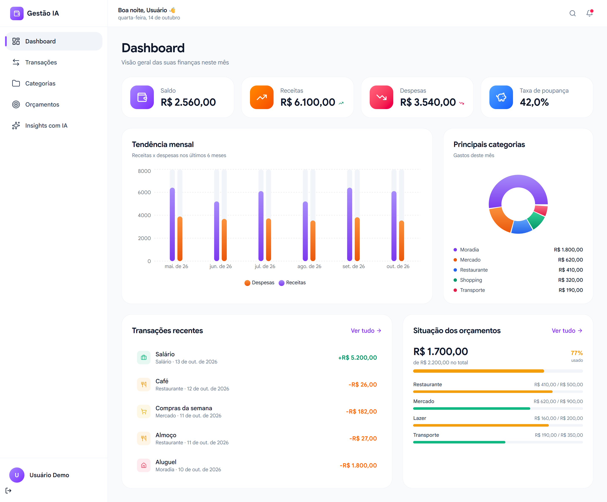
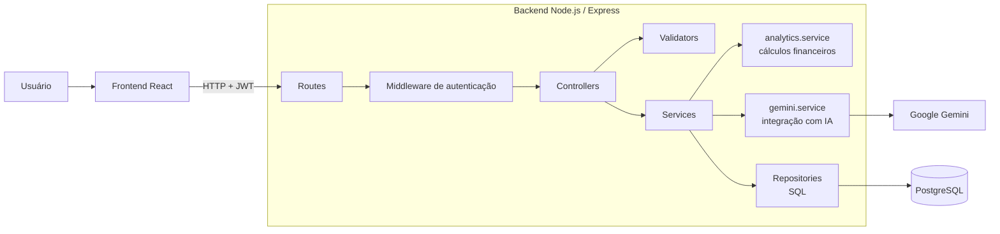
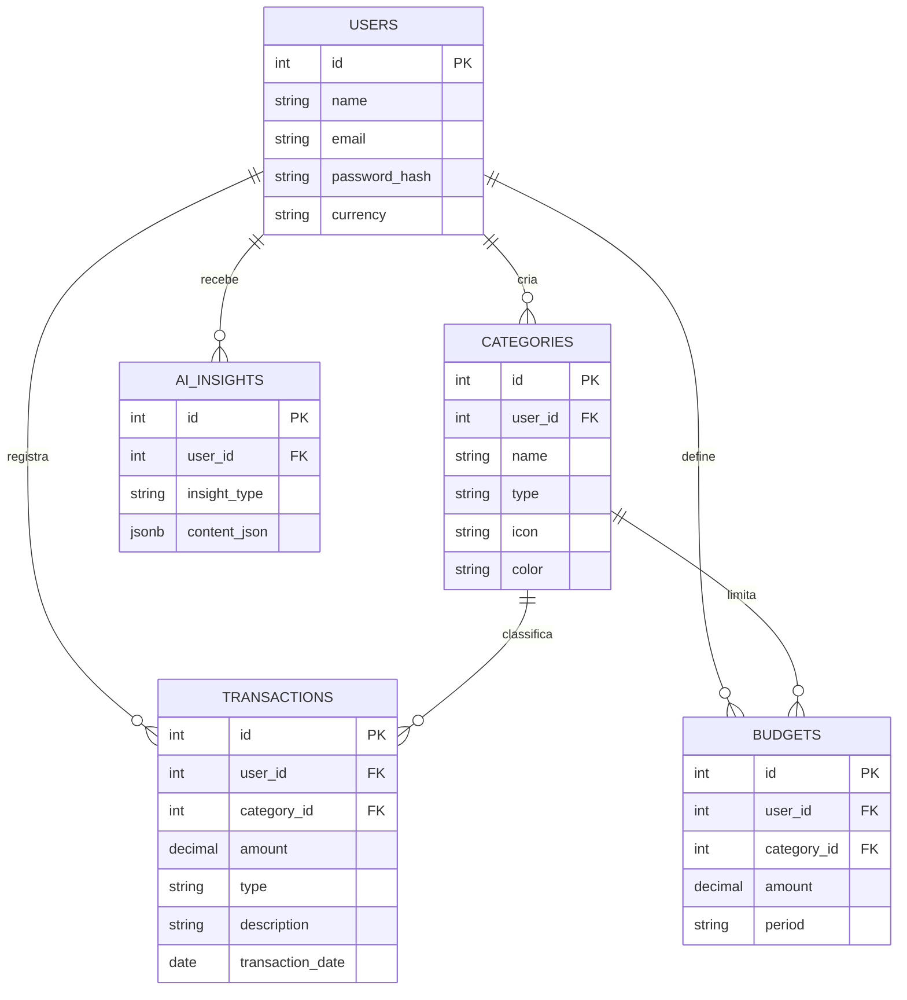
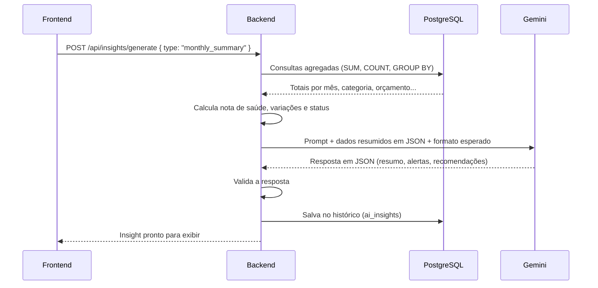
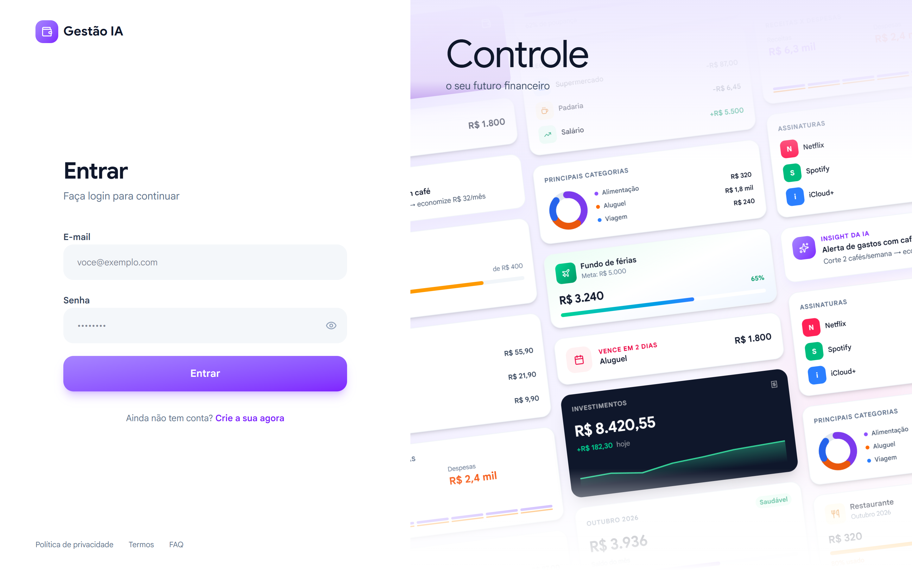
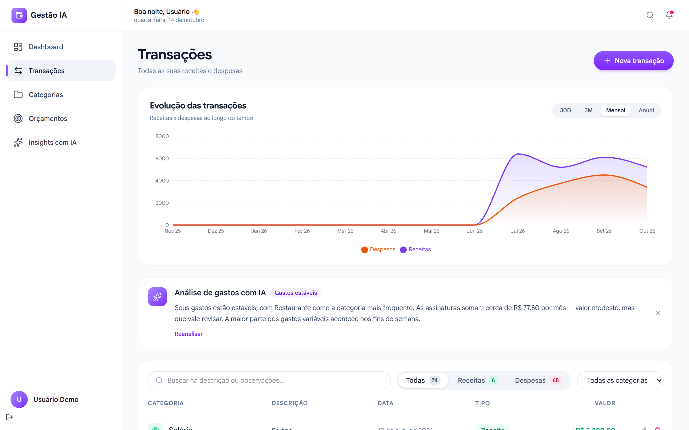
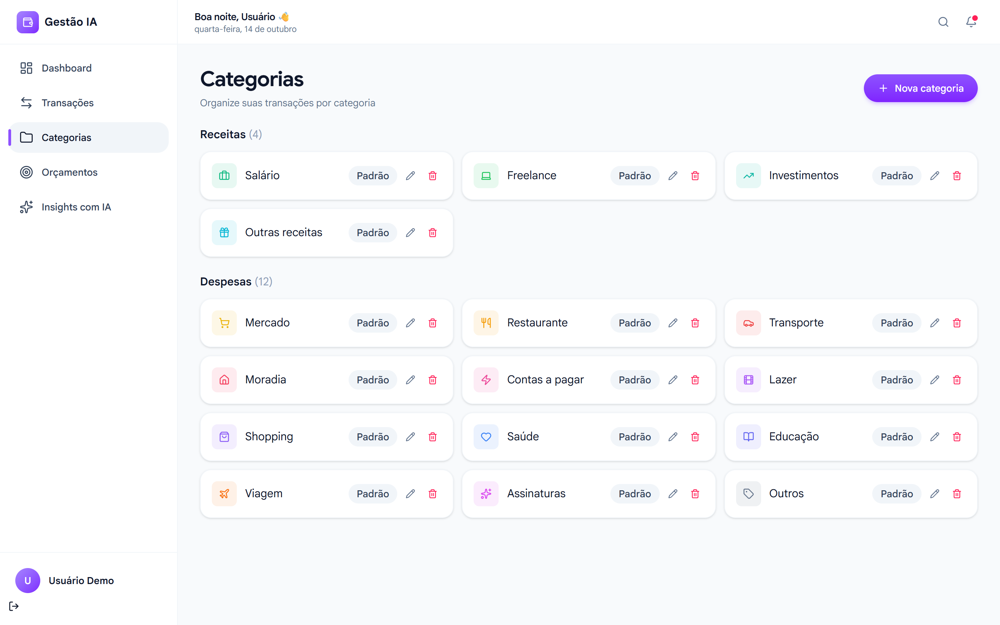
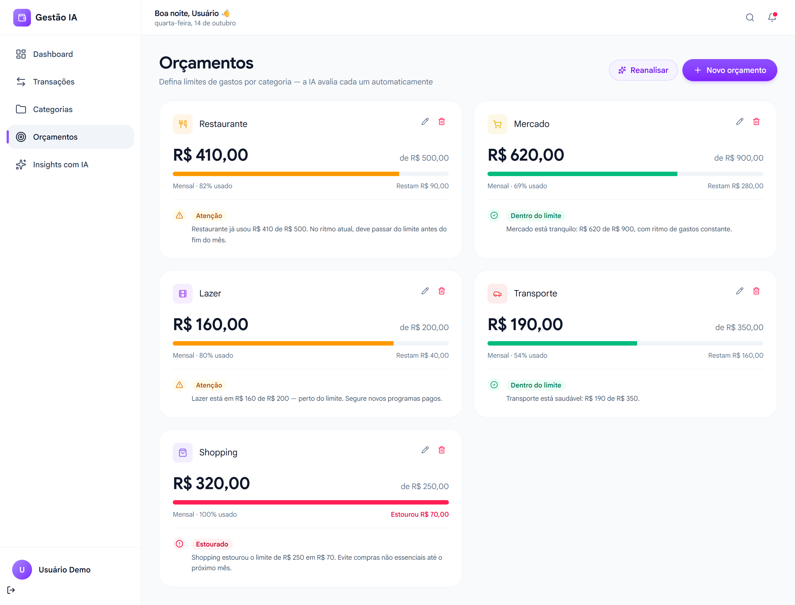
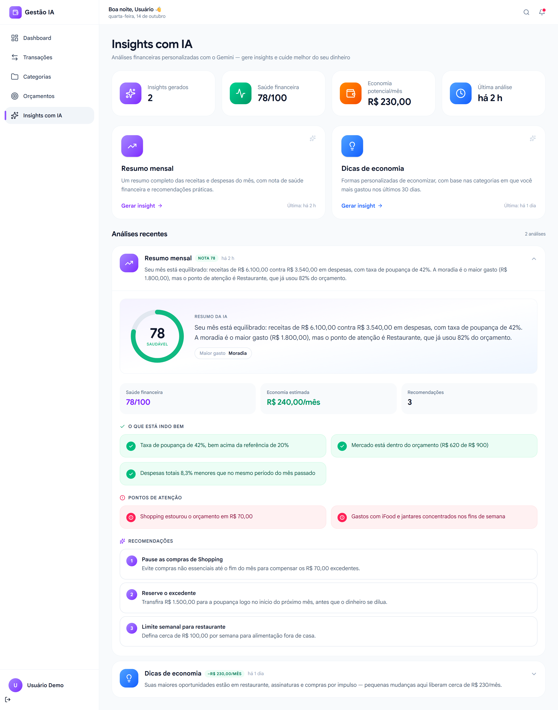
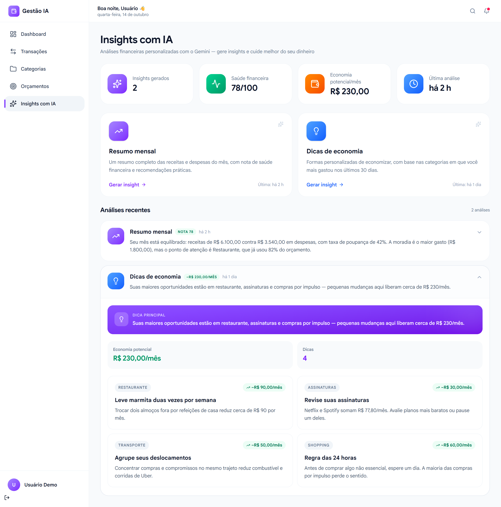

# Gestão IA — Controle de Gastos Pessoais com Inteligência Artificial

Aplicação web para registrar, organizar e analisar gastos pessoais. O sistema calcula os indicadores financeiros do usuário e usa o **Google Gemini** para interpretar esses dados e gerar feedback personalizado: resumo do mês, pontos de atenção, dicas de economia e alertas de orçamento.

Projeto desenvolvido como trabalho acadêmico por:

- **Anderson Rodrigues de Melo**
- **Gleyce Gomes de Oliveira**



---

## Sumário

1. [Problema e objetivo](#1-problema-e-objetivo)
2. [Funcionalidades](#2-funcionalidades)
3. [Tecnologias utilizadas](#3-tecnologias-utilizadas)
4. [Arquitetura](#4-arquitetura)
5. [Banco de dados](#5-banco-de-dados)
6. [Integração com a Inteligência Artificial](#6-integração-com-a-inteligência-artificial)
7. [Segurança](#7-segurança)
8. [API REST](#8-api-rest)
9. [Como executar](#9-como-executar)
10. [Testes](#10-testes)
11. [Telas do sistema](#11-telas-do-sistema)
12. [Estrutura de pastas](#12-estrutura-de-pastas)
13. [Limitações e trabalhos futuros](#13-limitações-e-trabalhos-futuros)

---

## 1. Problema e objetivo

Muitas pessoas não sabem com clareza para onde vai o próprio dinheiro. Planilhas exigem disciplina e conhecimento, e aplicativos prontos costumam impor categorias fixas que não refletem a realidade de cada um.

O objetivo do projeto é oferecer uma ferramenta em que o usuário:

- registre receitas e despesas de forma simples;
- **crie as próprias categorias** (Mercado, Restaurante, Assinaturas, Pet, ou qualquer outra), sem uma lista engessada;
- acompanhe totais, gráficos e limites de gastos (orçamentos);
- receba uma **análise em linguagem natural**, feita por IA, com base nos seus dados reais.

---

## 2. Funcionalidades

| Módulo | O que faz |
|---|---|
| **Autenticação** | Cadastro e login com e-mail e senha. Cada usuário só acessa os próprios dados. |
| **Categorias** | Criar, editar (nome, ícone, cor) e excluir categorias de receita e despesa. No cadastro, o sistema sugere 16 categorias iniciais, que podem ser alteradas ou removidas livremente. |
| **Transações** | Registrar receitas e despesas com valor, categoria, descrição, data e observações. Busca, filtros por tipo/categoria e paginação. |
| **Orçamentos** | Definir um limite mensal ou semanal por categoria. O sistema calcula quanto já foi gasto no período e indica se está dentro do limite, em atenção ou estourado. |
| **Dashboard** | Saldo, receitas, despesas e taxa de poupança do mês, com comparação ao mesmo período do mês anterior; gráfico dos últimos 6 meses; gastos por categoria; transações recentes e situação dos orçamentos. |
| **Insights com IA** | Geração de **resumo mensal** (com nota de saúde financeira de 0 a 100), **dicas de economia** e **alerta de orçamento**. As análises ficam salvas em um histórico. |
| **Análise rápida com IA** | Na tela de transações, a IA comenta o padrão de gastos das transações exibidas; na tela de orçamentos, comenta cada orçamento. |

---

## 3. Tecnologias utilizadas

**Frontend**

- React 19 + Vite
- Tailwind CSS
- React Router (navegação entre telas)
- Axios (comunicação com a API)
- Recharts (gráficos)

**Backend**

- Node.js + Express 5
- PostgreSQL (hospedado no Neon) com o driver `pg`, usando SQL puro
- JWT (`jsonwebtoken`) para autenticação e `bcryptjs` para senhas
- Google Gemini (`@google/genai`) para a análise com IA
- `node:test` para os testes automatizados

---

## 4. Arquitetura

O sistema é dividido em **frontend** (interface no navegador) e **backend** (API REST), que se comunicam por HTTP com dados em JSON.



Responsabilidade de cada camada:

| Camada | Responsabilidade |
|---|---|
| **Routes** | Define as URLs da API e qual controller atende cada uma. |
| **Middlewares** | Verifica o token JWT e trata erros, devolvendo sempre `{ message }`. |
| **Controllers** | Recebem a requisição, validam a entrada e devolvem a resposta. |
| **Validators** | Conferem tipos, formatos e limites dos dados recebidos. |
| **Services** | Regras de negócio: verificar se a categoria pertence ao usuário, calcular gastos, montar dados para a IA. |
| **Repositories** | Únicos módulos que acessam o banco, sempre com consultas parametrizadas e filtradas pelo usuário. |

---

## 5. Banco de dados



- **Categorias personalizadas:** cada categoria pertence a um usuário (`user_id`), então cada pessoa tem sua própria lista. Não existem categorias fixas no código.
- **Exclusão de categoria:** as transações dela ficam "Sem categoria" (`ON DELETE SET NULL`) e os orçamentos dela são removidos (`ON DELETE CASCADE`).
- **Valores monetários** usam `NUMERIC(12,2)`, evitando erros de arredondamento de ponto flutuante.
- **Insights da IA** são salvos em `JSONB`, preservando o histórico de análises.

O script completo está em [backend/sql/schema.sql](backend/sql/schema.sql).

---

## 6. Integração com a Inteligência Artificial

A decisão central do projeto é a divisão de responsabilidades:

> **O backend calcula os números. O Gemini interpreta e escreve o feedback.**

Assim, a IA não "inventa" valores: totais, percentuais, variações, nota de saúde financeira e situação dos orçamentos são calculados com SQL e regras determinísticas.

**Fluxo de uma análise:**



**Cuidados adotados:**

- **Privacidade:** a IA recebe apenas dados agregados (totais por categoria, descrições curtas e frequentes). Nome, e-mail e identificadores **não são enviados**.
- **Resposta estruturada:** o Gemini é instruído a responder em JSON com um formato definido (`responseJsonSchema`), e o backend valida a resposta antes de salvá-la.
- **Proteção contra instruções maliciosas:** o prompt orienta a IA a tratar descrições digitadas pelo usuário apenas como dados.
- **Falhas:** em caso de erro ou indisponibilidade da IA, a API retorna uma mensagem clara; na tela de orçamentos, o sistema exibe uma avaliação padrão para não interromper o uso.
- **Chave da API:** fica somente no backend (variável `GEMINI_API_KEY`) e nunca é enviada ao navegador.

**Nota de saúde financeira (0 a 100)**, calculada pelo backend:

| Critério | Pontos |
|---|---|
| Taxa de poupança (30% ou mais = nota máxima) | até 40 |
| Proporção de orçamentos dentro do limite | até 30 |
| Tendência das despesas em relação ao mês anterior | até 30 |

Toda a integração está concentrada em [backend/services/gemini.service.js](backend/services/gemini.service.js), e os cálculos em [backend/services/analytics.service.js](backend/services/analytics.service.js).

---

## 7. Segurança

| Item | Como foi tratado |
|---|---|
| Senhas | Armazenadas apenas como hash `bcrypt`, nunca em texto puro. |
| Autenticação | Token JWT com validade de 7 dias, enviado no cabeçalho `Authorization`. |
| Isolamento entre usuários | O id do usuário vem **somente do token**; toda consulta ao banco filtra por `user_id`. Um usuário não consegue ler, alterar, excluir nem analisar dados de outro — comportamento coberto por testes automatizados. |
| Categoria de outro usuário | Antes de salvar uma transação ou orçamento, o sistema confere se a categoria pertence ao usuário e se o tipo (receita/despesa) é compatível. |
| SQL Injection | Todas as consultas usam parâmetros (`$1`, `$2`...), sem concatenar dados do usuário. |
| Validação | Valores positivos com até 2 casas decimais, datas válidas, e-mail, tamanhos máximos, cores e ícones em formato permitido. |
| Login | Mensagem genérica ("E-mail ou senha inválidos") para não revelar quais e-mails existem. |
| CORS | A API só aceita chamadas do endereço do frontend configurado. |
| Segredos | `DATABASE_URL`, `JWT_SECRET` e `GEMINI_API_KEY` ficam em `.env`, fora do repositório. |

---

## 8. API REST

Todas as rotas têm o prefixo `/api`. Exceto cadastro e login, todas exigem o cabeçalho `Authorization: Bearer <token>`.

| Método | Rota | Descrição |
|---|---|---|
| POST | `/auth/register` | Cadastra usuário e devolve `{ user, token }` |
| POST | `/auth/login` | Autentica e devolve `{ user, token }` |
| GET | `/auth/me` | Dados do usuário logado |
| GET / POST | `/categories` | Lista / cria categorias |
| PUT / DELETE | `/categories/:id` | Edita / exclui categoria |
| GET / POST | `/transactions` | Lista (com `search`, `type`, `categoryId`, `limit`) / cria transações |
| GET / PUT / DELETE | `/transactions/:id` | Consulta / edita / exclui transação |
| POST | `/transactions/analyze` | Análise com IA das transações selecionadas |
| GET / POST | `/budgets` | Lista (com valor gasto) / cria orçamentos |
| PUT / DELETE | `/budgets/:id` | Edita / exclui orçamento |
| POST | `/budgets/analyze` | Avaliação com IA de cada orçamento |
| GET | `/dashboard/summary` | Saldo, receitas, despesas, taxa de poupança e variações |
| GET | `/dashboard/monthly-trend` | Receitas e despesas dos últimos 6 meses |
| GET | `/dashboard/category-breakdown` | Gastos do mês por categoria |
| GET | `/insights` | Histórico de análises da IA |
| POST | `/insights/generate` | Gera análise: `monthly_summary`, `savings_tips` ou `budget_alert` |

---

## 9. Como executar

### Pré-requisitos

- Node.js 20 ou superior
- Um banco PostgreSQL (por exemplo, gratuito no [Neon](https://neon.tech))
- Uma chave da API do Gemini ([Google AI Studio](https://aistudio.google.com/apikey))

### Modo demonstração (sem backend)

Para apenas visualizar a interface com dados de exemplo, sem banco e sem login:

```bash
cd frontend
npm install
echo VITE_USE_MOCK=true > .env.development.local
npm run dev
```

Acesse `http://localhost:5173`. Nesse modo os dados não são salvos.

### Backend

```bash
cd backend
npm install
cp .env.example .env      # preencha DATABASE_URL, JWT_SECRET e GEMINI_API_KEY
npm run migrate           # cria as tabelas
npm run seed              # (opcional) cria um usuário de demonstração
npm run dev               # API em http://localhost:8000/api
```

Usuário de demonstração criado pelo `seed`: **demo@gestao.ia** / **demo1234**, com cerca de 3 meses de transações e 5 orçamentos.

### Frontend conectado ao backend

```bash
cd frontend
npm install
echo VITE_API_URL=http://localhost:8000/api > .env.development.local
npm run dev
```

### Variáveis de ambiente do backend

| Variável | Descrição |
|---|---|
| `DATABASE_URL` | Endereço de conexão do PostgreSQL |
| `DB_SSL` | `false` para Postgres local sem SSL (padrão: SSL ativo, exigido pelo Neon) |
| `JWT_SECRET` | Segredo para assinar os tokens (valor longo e aleatório) |
| `GEMINI_API_KEY` | Chave da API do Gemini |
| `GEMINI_MODEL` | Modelo usado (padrão: `gemini-2.5-flash`) |
| `FRONTEND_URL` | Endereço do frontend liberado no CORS (padrão: `http://localhost:5173`) |
| `APP_TIMEZONE` | Fuso para definir "hoje" e "mês atual" (padrão: `America/Sao_Paulo`) |
| `DATABASE_URL_TEST` | Banco separado, usado apenas pelos testes |

---

## 10. Testes

O backend possui **23 testes de integração** que sobem a API e fazem requisições reais a um banco de testes. O Gemini é simulado, para que os testes não dependam de internet nem consumam a cota da API.

```bash
cd backend
# DATABASE_URL_TEST deve apontar para um banco exclusivo de testes (as tabelas são recriadas)
npm test
```

Fluxos cobertos:

- cadastro, login, e-mail duplicado, validação e rotas protegidas;
- CRUD de categorias, transações e orçamentos, incluindo validações de valor, data e tipo de categoria;
- **isolamento entre usuários** (um usuário tentando ler, alterar, excluir e analisar dados de outro);
- cálculos do dashboard (totais, taxa de poupança, tendência mensal, gastos por categoria);
- geração de insights, garantia de que dados pessoais não são enviados à IA e comportamento quando a IA falha.

---

## 11. Telas do sistema

| Login | Transações |
|---|---|
|  |  |

| Categorias | Orçamentos |
|---|---|
|  |  |

| Insights com IA — resumo mensal | Insights com IA — dicas de economia |
|---|---|
|  |  |

Todas as capturas estão na pasta [screenshots/](screenshots/). As versões formatadas como figuras para o trabalho estão em [screenshots/figuras-png/](screenshots/figuras-png/) e no arquivo `screenshots/Figuras - Gestao IA.docx`.

---

## 12. Estrutura de pastas

```
aplicativo-gestao-despesas-ia/
├── backend/
│   ├── server.js            # inicia o servidor
│   ├── app.js               # configura o Express (CORS, JSON, rotas, erros)
│   ├── db.js                # conexão com o PostgreSQL
│   ├── routes/              # definição das URLs
│   ├── controllers/         # entrada e saída das requisições
│   ├── validators/          # validação dos dados recebidos
│   ├── services/            # regras de negócio, cálculos e integração com o Gemini
│   ├── repositories/        # consultas SQL
│   ├── middlewares/         # autenticação JWT e tratamento de erros
│   ├── utils/               # datas e erros HTTP
│   ├── sql/schema.sql       # criação das tabelas
│   ├── scripts/             # migrate e seed
│   └── tests/               # testes de integração
├── frontend/
│   └── src/
│       ├── pages/           # telas (Dashboard, Transações, Categorias, Orçamentos, Insights...)
│       ├── components/      # componentes reutilizáveis, formulários e gráficos
│       ├── context/         # estado de autenticação
│       ├── libs/            # cliente HTTP (API real e modo demo)
│       └── utils/           # formatação de moeda/datas e dados de exemplo
└── screenshots/             # capturas de tela e figuras do trabalho
```

---

## 13. Limitações e trabalhos futuros

- **Hospedagem do backend:** atualmente o backend roda localmente; o próximo passo é publicá-lo (Render, Railway ou Vercel) para que o site no ar use dados reais.
- **Metas financeiras:** permitir objetivos de economia (ex.: viagem, reserva de emergência) acompanhados pela IA.
- **Importação de extratos:** ler arquivos CSV/OFX do banco para evitar o cadastro manual.
- **Perfil do usuário:** tela para alterar nome, senha e moeda.
- **Sessão mais segura:** trocar o token no `localStorage` por cookie `httpOnly`.
